# wembed_ui

An interactive viewer for [WEmbed](https://github.com/Vraier/wembed) graph embeddings.
Animate the live progress of an embedding or export images from already existing embeddings.

| | |
|---|---|
| 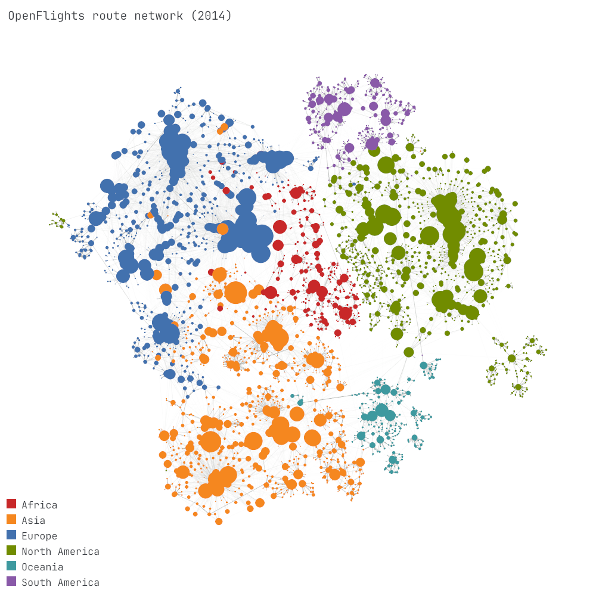 | 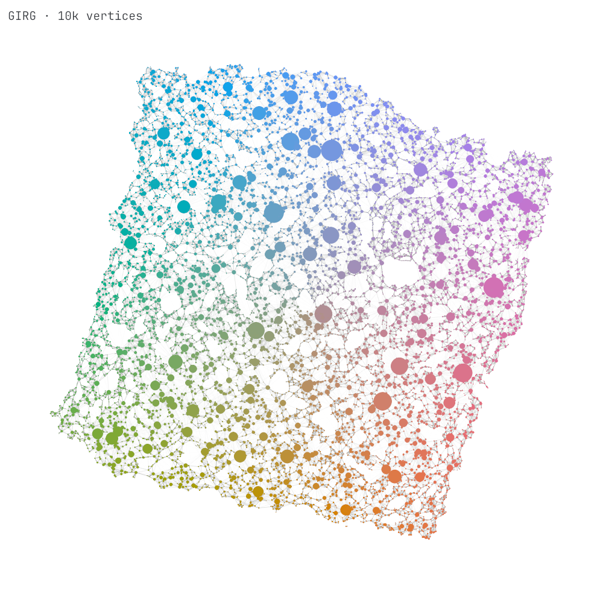 |

<sub>Left: the OpenFlights route network, colored by continent. Airports from the same continent form natural clusters.
Obtained from OpenFlights, which is made available under the ODbL.
Right: a random geometric graph. Color indicates the hidden coordinates used to generate the graph. WEmbed is able to reconstruct these coordinates based only on the graph topology.</sub>

## Building

You need Rust 1.88 or newer, a C++20 compiler with OpenMP, CMake 3.28 or newer, Ninja and a Vulkan driver
(on Ubuntu 24.04 / Debian 13: Rust plus `sudo apt install build-essential cmake ninja-build`).
```
git clone --recursive https://github.com/Vraier/wembed_ui.git
cd wembed_ui
cargo build --release
```
This builds `target/release/wembed-viewer`.
To build against a local WEmbed checkout instead of the pinned submodule, set `WEMBED_SRC=/path/to/wembed`.

With [Nix](https://nixos.org/) you can just run:
```
nix run github:Vraier/wembed_ui -- gui <graph.edg>
```
`nix develop` gives a shell with the full toolchain.


## Usage

```
wembed-viewer gui <graph.edg>                   # embed live in a window
wembed-viewer headless <graph.edg> -o out.png   # embed without a window and write a PNG
```
In the window, `Space` pauses (pan, zoom and hover to inspect), `S` saves a PNG and `E` saves the embedding.
You can modify the visualization in the ui and watch the different convergence signals.
A saved embedding can be loaded again with `--input-embedding`, which skips the embedder.
Embeddings with more than two dimensions (`--dimension`) are shown as a PCA projection.
`wembed-viewer gui --help` and `wembed-viewer headless --help` list all options.

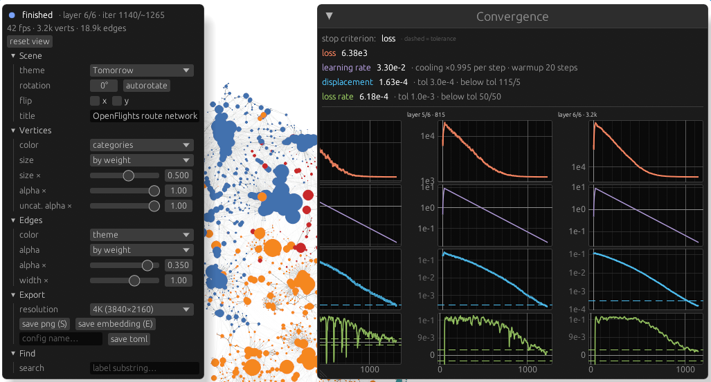 


## Configuration files

Every option can also be set in a TOML file passed with `--config`; flags given on the command line take precedence.
Paths inside the file are relative to the file itself, so a config and its data files can be moved together.
The export panel in the ui writes the current configuration as a TOML file.

```toml
graph = "graph.edg"

[embedder]
seed = 42
layered = true

[attrs]
labels = "labels.jsonl"
categories = "continents.txt"

[theme]
name = "tomorrow"

[visual]
vertex_color_source = "categories"
vertex_size_source = "weight"

[legend]
entries = [{ label = "Africa", category = 0 }, { label = "Asia", category = 1 }]

[text]
title = "OpenFlights route network (2014)"
```

## File Formats

| File | Format | Flag / TOML key |
|---|---|---|
| Graph | edge list, one `u v` pair per line, ids from 0, `#` comments | positional / `graph` |
| Embedding | CSV `id,x1,...,xd,w` | `--input-embedding` / `input_embedding` |
| Labels | one JSON string per line, line *i* = *i*-th vertex | `--labels` / `[attrs].labels` |
| Categories | one integer per line, `-1` = none; colored by the theme's accents | `--categories` / `[attrs].categories` |
| Colors | one hex color per line (`RRGGBB` or `RRGGBBAA`) | `--colors` / `[attrs].colors` |
| Edge colors | as colors, line *i* = *i*-th edge of the graph file | `--edge-colors` / `[attrs].edge_colors` |


## Examples

* [`examples/openflights`](examples/openflights): airports and routes, colored by continent.
* [`examples/girg`](examples/girg): a random geometric graph generated using the [girgs](https://github.com/chistopher/girgs) library. The color indicates the 2D coordinates used to generate the graph.

Run the examples with:
```
wembed-viewer gui --config examples/openflights/openflights.toml
wembed-viewer headless --config examples/openflights/openflights.toml -o openflights.png
```
The images at the top were rendered this way, with `--resolution 1000x1000`.


## Gallery

Real-world graphs rendered with wembed_ui. The data is not part of this repository.

| | |
|---|---|
| 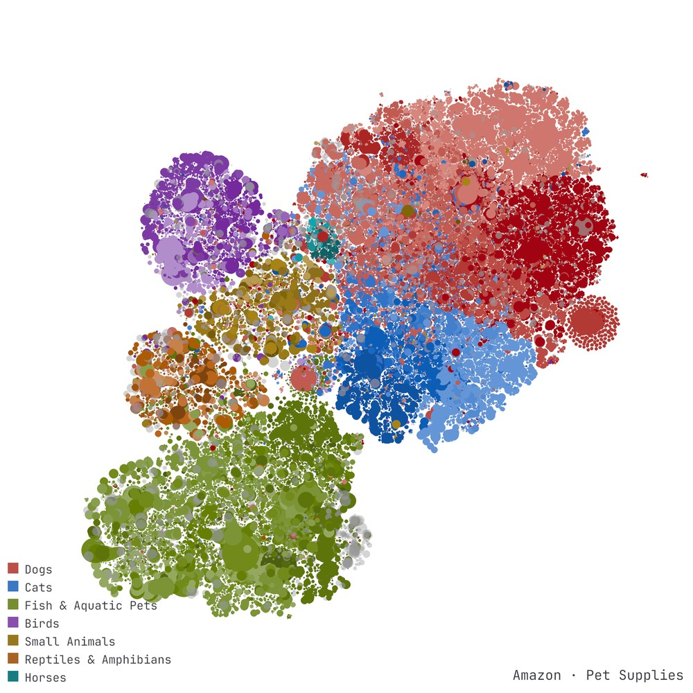 | 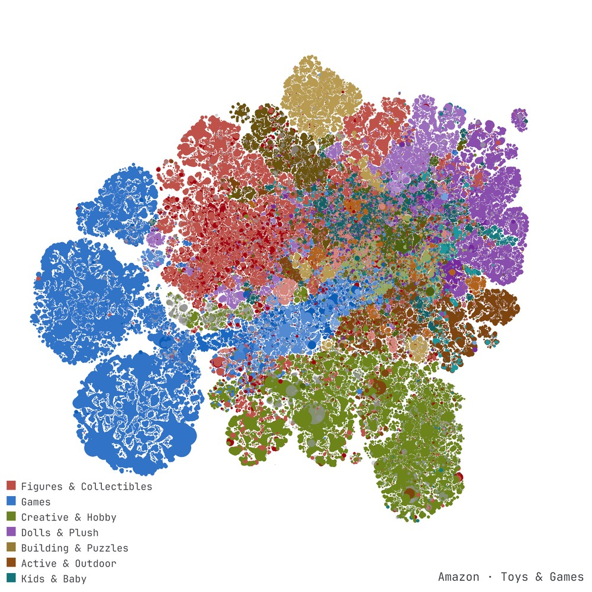 |
| Amazon Pet Supplies: products bought together, colored by sub-category [1] | Amazon Toys & Games, the same for toys [1] |
| 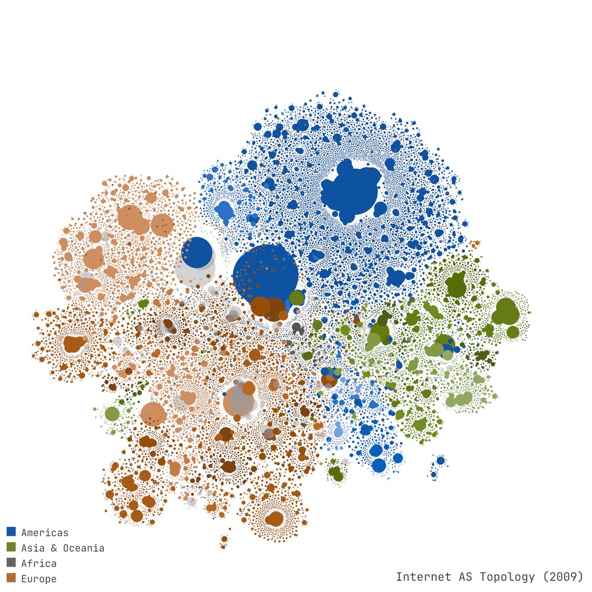 | 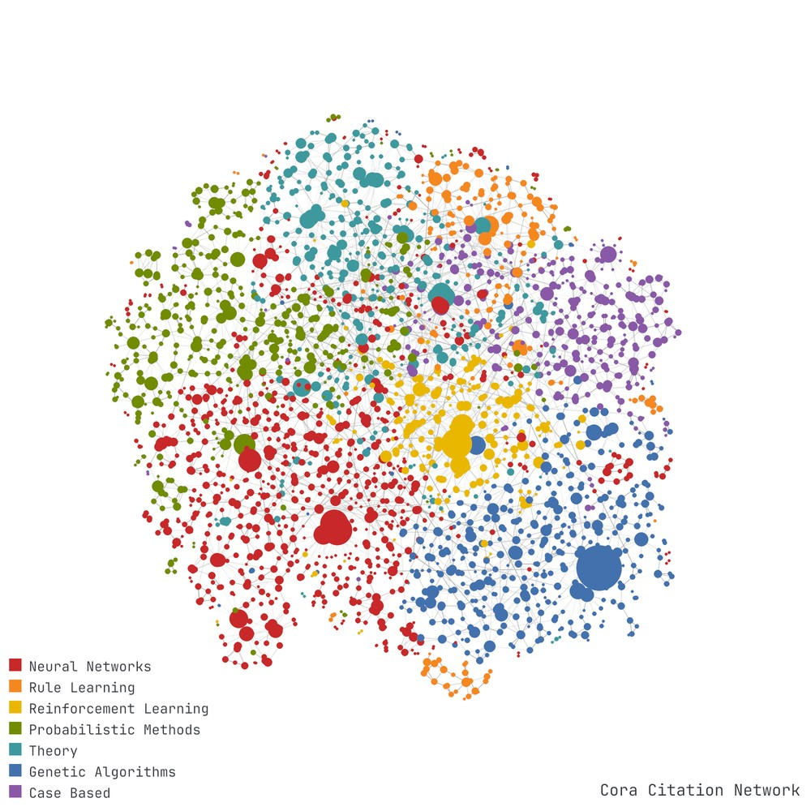 |
| The Internet at the level of autonomous systems (June 2009), colored by continent [2] | Cora: citations between machine learning papers, colored by topic [3] |

You can also use wembed_ui to draw simple maps.
The following renders keep their real coordinates from OpenStreetMap, loaded with `--input-embedding`.
The largest, Europe's road network, has 93 million vertices and 95 million edges and renders in under a minute with 6 GB of memory.
This is close to the GPU's buffer size limit, which allows graphs with up to roughly 250 million edges (on a GPU with 2 GiB buffers).

| | |
|---|---|
| 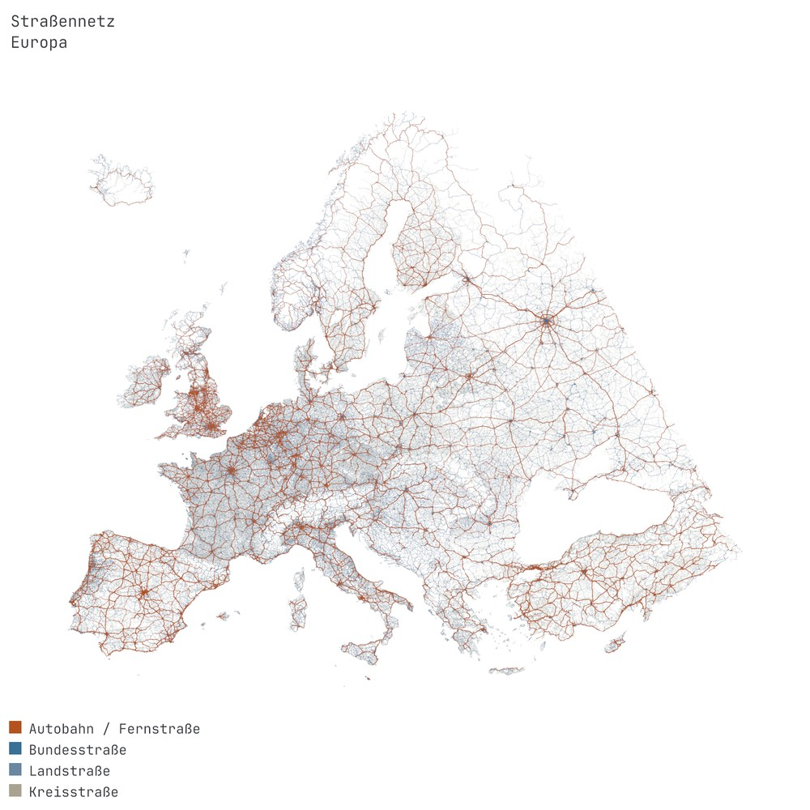 | 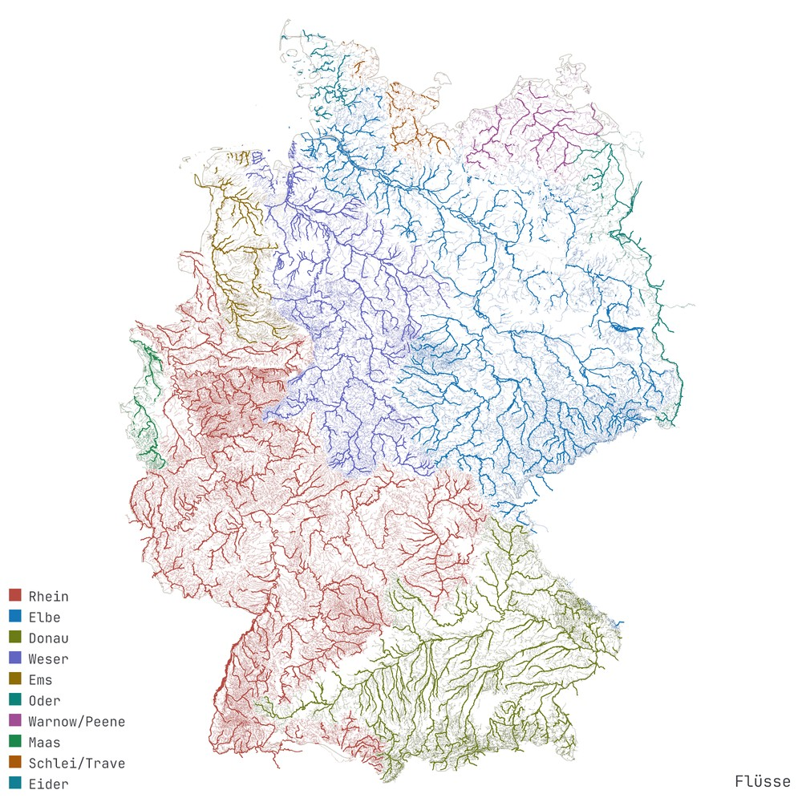 |
| Europe: arterial roads, colored by road class [4] | German rivers, colored by drainage basin [4, 5] |
| 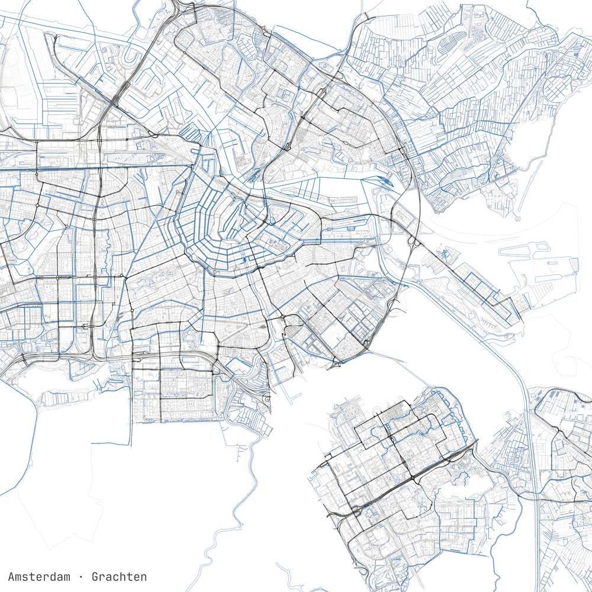 | 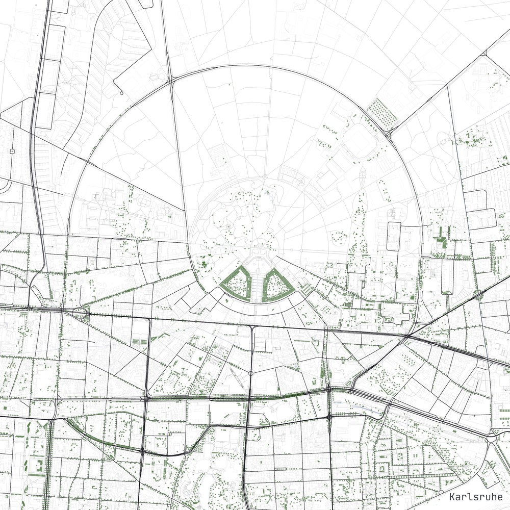 |
| Amsterdam: streets and canals [4] | Karlsruhe: streets, trees and parks around the palace [4] |
| 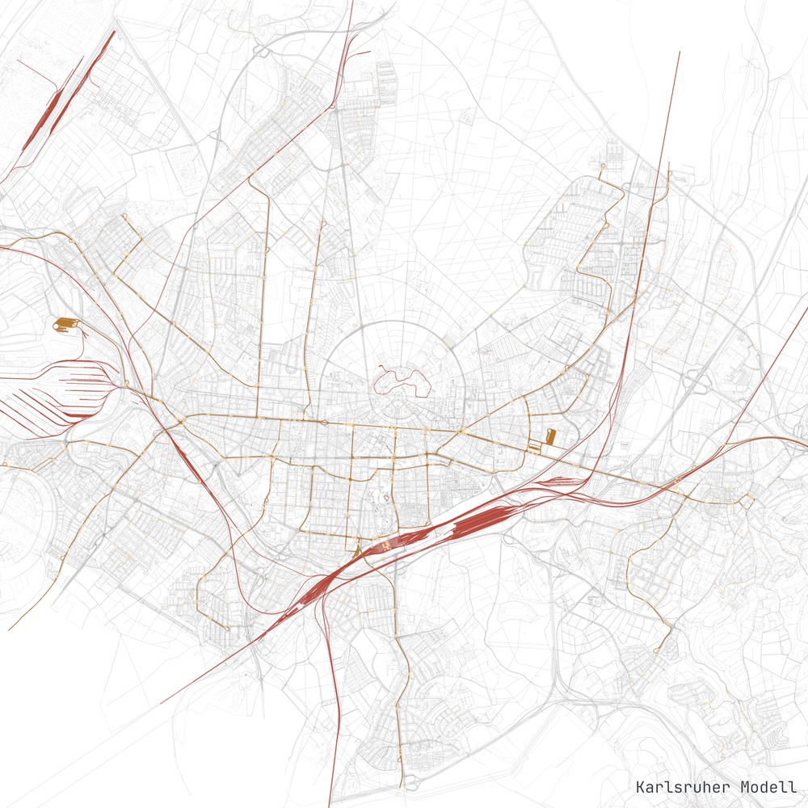 | |
| Karlsruhe: the tram-train network [4] | |

<sub>
[1] Ni, Li, McAuley, <a href="https://aclanthology.org/D19-1018/">EMNLP 2019</a>.
[2] Boguñá, Papadopoulos, Krioukov, <a href="https://doi.org/10.1038/ncomms1063">Nat. Commun. 2010</a>.
[3] Sen et al., <a href="https://doi.org/10.1609/aimag.v29i3.2157">AI Magazine 2008</a>.
[4] © <a href="https://www.openstreetmap.org/copyright">OpenStreetMap</a> contributors, ODbL.
[5] Basins © BfG.
</sub>


## Citing

If you use wembed_ui in your research, please cite the WEmbed paper:

T. Bläsius, J.-P. von der Heydt, M. Katzmann, N. Maas, [AAAI 2025](https://doi.org/10.1609/aaai.v39i15.33711).

```bibtex
@inproceedings{Weigh_Embed_LowDi_Graph_AAAI2025,
  title     = {Weighted Embeddings for Low-Dimensional Graph Representation},
  author    = {Thomas Bläsius and Jean-Pierre von der Heydt and Maximilian Katzmann and Nikolai Maas},
  pages     = {15587--15595},
  year      = {2025},
  booktitle = {AAAI Conference on Artificial Intelligence (AAAI)},
  doi       = {10.1609/aaai.v39i15.33711}
}
```


## License

MIT, see [LICENSE](LICENSE).
The bundled color themes are from [tinted-theming](https://github.com/tinted-theming/schemes) (MIT, see [themes/LICENSE](crates/wembed-viewer/themes/LICENSE)).
The example data keeps its own license.
